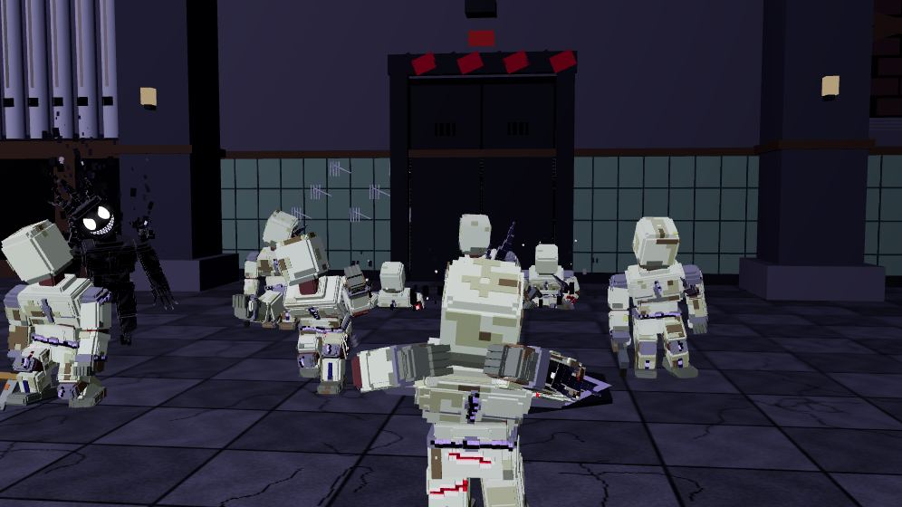
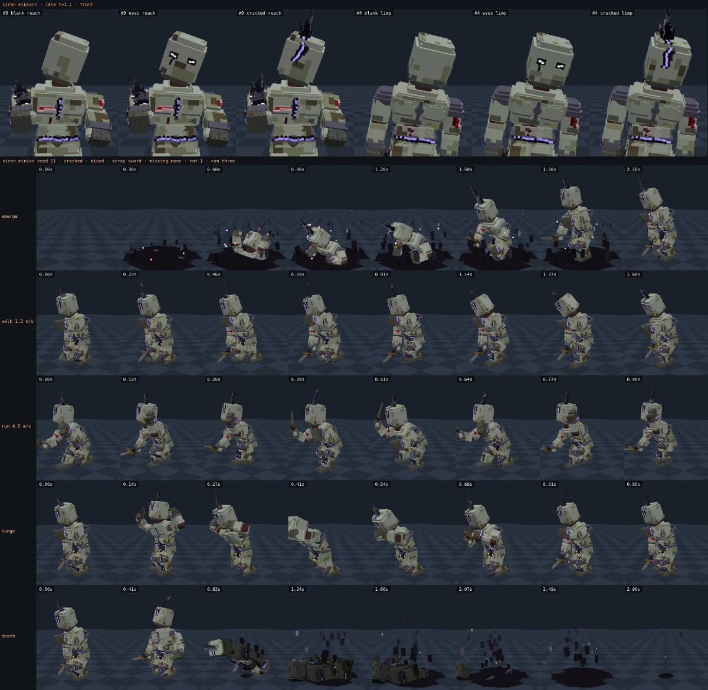

# Siren minions: zombie Pilots (design)

Owner request (2026-10-02): the Siren gets minions. They are procedurally generated Pilots (our player model) that act
like zombies, spawn throughout the map, and are friendly to the Siren and its team. They are zombie-like: rot, black
flame burns, wounds. "After design, we can work on spawn logic and etc."

**Status: design phase, presentation only.** The look, the animation set and a review gallery are implemented in
`src/client/siren/minions/**` (task branch `claude/visual-revision-siren-minions`, integrated via
`claude/visual-revision-draft-minions`). **Nothing in the game uses them yet.** There are
no spawns, AI, damage, network fields or renderer wiring. The systems contract at the end is a proposal. Spawn rules,
caps, the AI and the snapshot fields are next-phase work and need the owner and Astra (the systems owner) to agree on them.





Top row of the sheet: the three face options (blank, eyes, cracked) on two seeds. Blank is the default; about a quarter
of the seeds get the cracked head; eyes appear only when asked for. Below it: seed 11, one of the cracked-head seeds:
emerge, walk 1.3 m/s, run 4.5 m/s, lunge, and death (headless SwiftShader, lab lighting). The horde above shows the
default faces.

## The look

Each minion is the normal Pilot rig: `createCharacterRig`, `RIG_VERSION` 2, with the same joint, socket and mesh names.
Because of that, every pose helper, IK, LOD and ragdoll path keeps working. The seed then corrupts the rig
deterministically:

- **Rot.** The shell turns ashen grey-green. Each part gets its own slight tint.
  - Uneven decay blotches with darker brown cores and rare sickly ooze specks.
  - Decay gathers low on the body and around burns and wounds. Some parts stay almost clean.
  - Grime runs down the lower end of every part.
  - The joints show dried flesh and blood. The gloves and boots are just filthy.
- **Black-flame burns** on 1–3 parts:
  - Charred black patches with pale violet ember cracks and a sooty, scorched rim.
  - Black-flame tongues lick off them. A tongue is the Siren's ink material in a voxel cluster: dark at the root, paling
    toward the tips, flickering and swaying.
- **Wounds** on 0–4 parts (usually 1–3):
  - Real openings carved with the body-damage carver (`body-wounds.ts carve`): a cavity, a slash, or a pair of
    punctures. The openings are lined with flesh and have torn rims.
  - A blood run drips below each wound.
- **Missing parts**, on about a third of the minions:
  - A hand or a forearm, leaving a stump with flesh, a protruding bone and a burnt ragged band.
  - Or the jaw plate, leaving a row of teeth and a dark hollow.
- **Dying glow.** The Pilot's glowing armor is dead:
  - The accent plates are dark grey-violet. Most of them have one crack that leaks the Siren's pale violet light, and
    some are fully dead.
  - The glow strips break into failing segments.
  - Everything flickers, and the whole minion's glow drops out now and then, like failing power.
- **Face.** Blank like every Pilot; about a quarter of the seeds have a cracked head shell leaking black flame. See below.
- **Weapon scraps**, in about half of the minions that have a right hand: a broken sword, a pistol held by the barrel,
  or a length of pipe, used as a club.
- **Body language.**
  - Hunch, head tilt and a dropped shoulder.
  - Arms that reach, hang limp, or one of each.
  - A dragged leg with a limp.
  - The walk and run cadence, and how often and how hard it twitches.

Every seed looks different, but they all share one palette and one set of rules, so they read as one family. Gore is
stylized and voxel-sized, in the same tone as the existing wounds. The palette lives in one place:
`materials.ts MINION_PALETTE` and the per-category self-light and glow.

## Face (owner decision, 2026-10-02)

The owner chose a **blank** face as the default, with **some seeds cracked**, and no burned-in eyes in the random pool.
`seededFace(seed)` picks the face from its own hash, so the other knobs of a seed do not change: about 25% of the seeds
(`CRACKED_FACE_SHARE`) are cracked, the rest blank. `createSirenMinion(seed, {face})` still forces any option.

| Face | Who gets it | Look |
| --- | --- | --- |
| `blank` (**default**) | About 75% of the seeds | No face: the rotted Pilot head. Closest to the Pilot; reads as "dead pilot". |
| `cracked` | About 25% of the seeds | The head shell is split, the crack leaks violet light, and black flame burns from the crown. It adds one tongue, and the tongues are the first to be cut in low detail. |
| `eyes` | Only when `{face:'eyes'}` is passed; never seeded | Faint white Siren-style eyes burned into dark sockets. Kept as an explicit option only. |

Only the head and crown carry the face. Other parts' shared layouts never depend on it, so a layout is the same whichever
minion built it first (a cracked minion used to paint its crack onto every part it built first; fixed and tested).

## Variety knobs

The seed decides every knob. `MinionOptions` overrides any of them, for tests, the lab and future systems such as an
elite variant.

| Knob | Range (seed) | Override |
| --- | --- | --- |
| Rot | light / medium / heavy (quantized so layouts can be shared) | `rot` 0..1 |
| Burns | 1–3 parts (back, torso, arms, legs, head side) | `burn` 0..1 |
| Wounds | 0–4 carved openings, usually 1–3 (cavity / slash / punctures) | `wounds` |
| Missing | none, left/right hand, left/right forearm, jaw | `missing` |
| Weapon scrap | none, sword, pistol, pipe (needs a right hand) | `scrap` |
| Arms | reach, limp, mixed | `arms` |
| Hunch | .18–.5 rad | `hunch` |
| Asymmetry | head tilt ±.35, shoulder drop .04–.16, dragged leg and limp .35–1 | (seed) |
| Rhythm | walk and run cadence, twitch rate .25–.6/s, jerk .5–1 | (seed) |
| Glow phase | 4 material pools, so neighbouring minions do not flicker in step | (seed) |

## Animation states

The poses come from the fields listed below, the seed and the time. Each minion keeps one small state, its gait phase:
the cadence follows speed, so the phase has to accumulate. It is one cycle whose stance, reach, lift and heel blend from
the shamble into the run, integrated with trapezoidal steps so a timestamp gives the same stride at 30, 60 and 120 Hz even
after a speed change. The state also keeps a smoothed yaw rate so planted feet stay put while the minion turns. It is
deterministic, clamps dt to .05 s, and restarts when time runs backward or jumps by more than .35 s (kill-cam rewinds,
late snapshots). The animation draws no random
numbers anywhere. Layers blend inside a numeric pose buffer, so states hand over without pops.

| State | Needs | What it does |
| --- | --- | --- |
| Idle | `yaw`, `vel` ≈ 0 | Weight drift, irregular breathing, head lolling, Siren-like head and shoulder twitches and spasms at hashed times. |
| Shamble | `vel` < 2 m/s (`hp`/`maxHp` below 40% sags it lower) | Hunched, lurching walk. One foot drags low, toe down, and swings out. The torso dips on the bad leg and pitches forward on each good step. Arms swing loosely or reach. |
| Frenzied run | `vel` > 3 m/s (cross-fade 2–3) | Crouched sprint with the head up, high knees, and wild alternating arm flails (reaching minions claw forward). |
| Lunge (grab) | `attackAt`, kind `lunge` | Claws raised, lunge, two-hand grab at chest height, bite, recover. Hands use IK. |
| Club | `attackAt`, kind `club` (default with a scrap) | Overhead wind-up with a torso twist, a diagonal swing through, and the free arm out for balance. |
| Smash | `attackAt`, kind `smash` | Two-handed hammer fist from overhead. |
| Flinch | `hitAt`, optional `hitYaw` | A snap away from the hit that rings out over .42 s, layered on any state. |
| Emergence | `spawnAt` | A black-flame pool spreads, hands burst out of the floor, the head and shoulders rise, the hands slam the floor and haul the body up, a knee comes out, and it jerks awake into its walk (1.95 s). |
| Death | `deathAt` | Starts from the exact pose at death. It recoils, the knees buckle, and it topples forward with its arms trailing. The body comes to rest on its knees, chest and head instead of sinking into the floor, and a weapon scrap swings flat. It chars part by part and burns away feet first, head last, into black flame and ash (2.3 s). Effects end at 3.1 s, leaving a scorch. |

- **Feet are ground-anchored.** Both legs use the shared IK (`rig-ik foot`). A planted foot moves backward in the rig
  exactly as fast as the body travels and turns against the body's yaw rate, and the cadence rises with speed so a
  stance never asks the short legs to reach too far.
- **Measured with the shared probe** (`tests/helpers/motion-probe.ts`) at 30/60/120 Hz:
  - Straight at .8, 1.3 and 4.5 m/s, and inside the walk-run band at 2.3 and 2.8 m/s: the good foot slips under 2 cm and
    the median planted-foot speed is 0.
  - Turning at 1.5 rad/s while walking 1.1 m/s: the good foot slips about 1 cm (was up to 11 cm), the median planted speed is
    under .03 m/s (was .27; the remainder is the probe's own root integration on a curve and halves per rate doubling).
  - Speeding up from 1.1 to 4.2 m/s in .5 s: the good foot slips at most 8 cm (was 21 cm).
  - After that ramp, feet and hands at 30 and 120 Hz agree within 1 mm (was 2–7 cm).
  - The dragged foot scuffs by design.
- **Floor contact.** The fallen body stays within about 4 cm of the floor (it used to sink up to .43 m: hands, knees,
  head), and a scrap rests on the floor alive and dead instead of spearing through it (alive it dragged up to 13 cm
  under, dead up to .5 m; now at most about 4 cm alive and 11 cm for a pipe's hook while the body burns).
- **Attack hit times.** The claws or club arrive at `MINION_TIMING.hit`: lunge .34 s, club .40 s, smash .43 s after
  `attackAt`. The full cycle is .9 s, the chaos zombie's cooldown.

## Performance

These are Node CPU measurements in this container, not the owner's GPU. They come from `prewarm`, `createSirenMinion`,
`animateSirenMinion` and `sirenMinionStats`.

**Meshes and triangles per minion:**

| | Value |
| --- | --- |
| Meshes | ≤ 53 (target ≤ 55), average 51.7; about 50 drawn when idle |
| Base | The Pilot rig's 48 meshes, minus hidden missing parts |
| Additions | Up to 3 tongues (the third is hidden in low detail), 1 weapon scrap, 1 effect mesh (drawn only while emerging or dying) |
| Instances (voxel boxes) | Average 920 (max about 1,330 over 200 seeds), against the Pilot's 218 |
| Triangles | About 11,000 per minion (max 16,000); a Pilot is 2,600 |
| Rot, burns, cracks, eyes, wound flesh | Instance colours in the parts' own layouts, so they cost no draw calls |

**Sharing:** every minion shares the geometry, layouts and materials. That is at most 48 materials: 6 categories × 4
flicker pools × alive/charred. Every layout a seed can need is about 800 cached layouts, around 1.5 MB.

**Creation cost:**
- Cold, before a prewarm: a median 13 ms per minion (p90 29 ms), because each new seed carves and paints the part
  layouts it is the first to need. Building minions is not a prewarm: after 24 of them, most new seeds still built new
  layouts (the earlier "1.6 ms once warm" only held for seeds already seen).
- `prewarmSirenMinions(budgetMs = 3)` enumerates the whole layout space (every part × condition × variant × rot level ×
  blank/cracked face) and builds it a slice at a time: about .5 s of CPU in about 125 slices of 3–5 ms (the first slice
  also builds a reference rig). Call it once per frame during the Siren intro until it returns true.
- After it: a median .75 ms per new minion (p90 1.3 ms), and no new seed builds a layout (tested over 120 seeds).

**Animation cost for 20 minions:**

| State | Per minion | Per frame |
| --- | --- | --- |
| Alive (walk, run, attack mix) | 22 µs | 0.43 ms |
| Emerging | 29 µs | 0.58 ms |
| Dying | 34 µs | 0.67 ms |

Dying costs a little more than before: the fallen body is posed twice when a knee, the chest or the head would push
through the floor (lift, then re-solve the legs). These numbers come from a CPU shared with another job, so treat them as
upper bounds.

**Low detail** (`setSirenMinionDetail`; the **SVG compatibility path only**): every part becomes its tinted plain box,
the third tongue is hidden, and the effects drop to half the cubes when quality < .5. Plain boxes lose the rot, burns and
wounds, so low-detail minions read as grey Pilots and could be mistaken for enemy players. Keep full detail on
'performance' graphics: the draw count is the same, and only the instance count differs.

**Budget risk: draw calls.** 20 minions are about 1,000 draws, plus a shadow pass. Recommendations for the next phase:
- Cap alive adds at about 12.
- Turn `castShadow` off beyond about 15 m.
- If larger hordes are wanted, add a crowd renderer that draws all minions' boxes per material in one instanced draw.
  The shared layouts make that possible.

## Proposed systems contract (NOT implemented; owner + Astra)

**Snapshot.** Reuse the chaos minion pipeline. It already has `MinionView`, `summon`, `removeMinion`, `hitMinion`, chase
AI, `enemy()`/`canHit()` friendliness and the cap of 34. Add a kind with optional fields:

```ts
// src/shared/chaos.ts (systems owner)
interface MinionView { id; owner; kind:'zombie'|'toy'|'siren-add'; pos; yaw; hp; maxHp; speed; until; lastAttack;
  seed?:number;      // uint32 look seed (or derive minionSeed(id))
  vel?:Vec;          // feet and gait (needed for siren-add)
  spawnAt?:number;   // emergence start; the add is inert for MINION_TIMING.emerge
  attack?:'lunge'|'club'|'smash';  // lastAttack is attackAt
  hitAt?:number; hitYaw?:number;   // last damage taken, for the flinch
  deathAt?:number;   // keep the add in the snapshot (no collider) for MINION_TIMING.deathFx after death
}
```

A separate `Snapshot.sirenAdds` would also work, but it would duplicate the minion systems. Keeping a dead add in the
snapshot for 3.1 s keeps the death rewindable for the kill-cam.

**Friendliness.** `owner` is the Siren player's id.
- The existing rules then give the requested behaviour:
  - `enemy(owner, q)` picks targets.
  - `hitMinion` ignores the owner and allies.
  - `canHit` honours teams and the friendly-fire option.
- The result: adds never target or hurt the Siren or the Siren's team, and the Siren's attacks should pass through its own adds.
- If the Siren dies or disconnects, its adds burn away: `deathAt` is set, which plays the death presentation.

**Spawns.**
- In Ward Zero: `SIREN_ADD_SPAWNS` (4 isolation cells and 4 ward doors, each with an inward yaw). The emergence pool
  fits a cell or a doorway.
- Multi-add waves need a clearance check: the cells are about 2.4 m from the back wall (DEV_LOG Ward Zero risk).
- Emergence keeps the body up to about 2 m below the spawn point's floor for about 1.4 s and relies on an opaque floor to
  hide it. A spawn picker must reject upper platforms, thin floors, glass and floor edges, or the buried body shows from
  below or from the side.
- Elsewhere ("throughout the map"): a shared `sirenAddSpawnPoints(map)` helper. It would raycast floor points on a grid,
  away from props, vents and players (for example ≥ 4 m), preferring points out of the target's view.

**Suggested tuning to start from** (owner decides):
- At most about 12 alive (performance).
- Waves of 2–4, cued by the boss song's sections.
- 60–120 HP each.
- Shamble at 1.1 m/s and run at 4.2 m/s (frenzy when close or below half HP).
- Melee range 1.6 m, 8–12 damage, .9 s cooldown.
- Inert while emerging.

**Client wiring (systems/integrator):**
- In `ChaosVisuals`, skip `kind==='siren-add'`. A small `SirenAdds` view then builds `createSirenMinion(seed)` per id.
- Each frame, set `group.position = pos` and `rotation.y = yaw`, then call `animateSirenMinion(minion, view, state.time)`.
- Call `setSirenMinionDetail(minion, true)` only on the SVG compatibility path (see Low detail).
- Run `prewarmSirenMinions(3)` once per frame during the Siren intro until it returns true.
- Dispose each minion after `deathFx`.
- A minion rig's parts carry the minion layouts as their current layout, while `retagVoxelPart` still records the clean
  Pilot sculpt as each mesh's base. So never run these on a minion rig: `recolorCharacterRig`, `dressRig`, a
  `retagVoxelPart(mesh)` reset, a body-wounds carve (`body-wounds.ts` carves from `baseLayout`), body collapse, or the
  death-effects voxel bursts. Each would repaint it or revert it to a clean Pilot. Route minion damage to the minion's
  own flinch and death instead.
- Minion instance colours of `GLOW_FLAG` (16) or more mark glowing cells for the minion materials. Any other consumer
  that reads layout colours (a burst that copies part colours, for example) would blow out on them.
- Re-export the minion façade from `src/client/siren/index.ts`. That file is the Siren visual owner's façade and was not
  edited in this design pass.

**Network cost:** about 70 bytes of JSON per add per snapshot, so 12 adds come to about 1 KB per snapshot.

**Open questions for the owner:**
- Wave pacing and caps.
- Whether adds appear outside Ward Zero.
- Whether players can block or roll their attacks like a player's melee.
- Whether the Siren's chips buff them.

## Review

Run `npm run dev` and open `/tools/visual-lab/index.html` with one of these queries (the parameters are listed in the
`tools/visual-lab/minions.ts` header):

- `?kind=minions` shows a grid of 12 seeds idling with their seeded faces. Add `&pilot=1` for a Pilot reference cell,
  `&faces=1` for every face option (eyes included), `&face=eyes` to force one, or `&low=1` for low detail.
- `?kind=minions&view=strip&seed=7&states=idle,walk,run,lunge,club,smash,flinch,emerge,death&cam=side` shows one row per
  animation state.
- `?kind=minions&view=ward&siren=1&aspect=1.778&song=50&camFwd=13.5` shows the horde in Ward Zero at a ward door.

A Developer Sandbox preview button was **not** added: it needs edits to `main.ts` and the renderer outside this design
pass.

## Checks (this branch)

- `tests/siren-minions.test.ts` (7 tests), all passing:
  - determinism and variety;
  - the rig contract and budget;
  - Lambert/Basic materials only;
  - low-detail fallback;
  - finite poses in every state;
  - emergence below the floor and burn-away;
  - no pops at death, emergence, attacks or flinch;
  - planted feet at 30/60/120 Hz;
  - rewind;
  - no `Math.random`;
  - the glow-flag encoding.
- `npm run check:types`, every `tests/siren-*.test.ts`, the voxel-model tests and the full suite. Results are in the
  branch handoff.
- Headless SwiftShader renders only. Native Windows/GPU look and frame rate were not checked.
