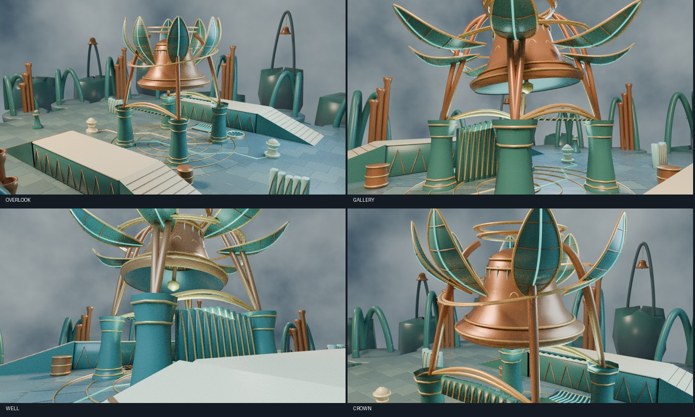

# Thunderheart Carillon

Thunderheart Carillon is retired from stage selection and random rotation. The bell's bronze crown overlooks two terraced galleries. The high ground has four ramp approaches. Breaking the amber or jade tuning stop sacrifices cover and powers the opposite updraft. Its two-second warning gives an opponent time to contest the landing. The north iris warns at 33 seconds in the opening round and starts closing at 36. The south iris follows 14 seconds later. A leaf holds above a pilot or minion in its sweep.

The two iris gates, breakable stops, launch wells, crosswind bellows, charged grate, breakable votive screens, movable drums and proximity bells respond to match state. Prop destruction and launch decisions use the existing arena authority. Gate warnings and the crown read the match clock. Muting music leaves those cues visible. Settings → Music-reactive scenery scales cosmetic motion and lighting.

## Sound and art

The supplied 224-second track drives a 10 Hz precomputed envelope with bass, midrange, treble and attack. Its playback cursor and the score sample the same fight time. The mesh bank has 28 batches and 133,434 triangles. The reproducible art source is in tools/stages/thunderheart_art.py under the Unity project. The four views below are offline art renders.

## Optional private lighting

The public stage uses native rain, moving light shafts and a shared surface shader. The builder archive inspected during development contained none of the requested commercial lighting or weather packages. Native lighting is the measured implementation only on the CPU hazard side. GPU cost and vendor quality differences require a matched camera capture on the target machine.

For a private configuration, import the licensed packages into the local builder overlay and create a Resources/CarillonPrivateAtmosphere prefab. Add CarillonAtmosphereBridge to its root. Put Volumetric Light Beam under beamRig and exactly one weather solution under weatherRig. Bind the float events to private adapter methods controlling intensity, wind and the crown transition. The bridge disables the corresponding native effects while the private rig owns them. Verify low graphics, round restart and leaving the map. Keep the prefab, vendor assets and baked data private.

Bakery needs static, authored scene or prefab geometry with suitable lightmap UVs. The current render path draws runtime meshes. A private bake therefore requires a static copy of the terraces and piers, UVs and a renderer binding for the bake. Keep the animated crown, gates and weather dynamically lit. No vendor installation, bake, or visual comparison has been verified.

## Verification

Run CoreTests with --thunderheart for roster sizes 1, 2, 4, 6 and 8, team and FFA spawns, gate warning and reset, opposite-well routing, song looping, envelope separation and every triangle index. The initial managed hazard benchmark over 60,000 ticks measured 0.165 microseconds per tick against Hollow Sanctum's 0.229 on the same runner. This excludes Unity physics, drawing, audio and networking. A Windows host/guest playthrough, performance capture and synchronized gameplay video remain unverified.
