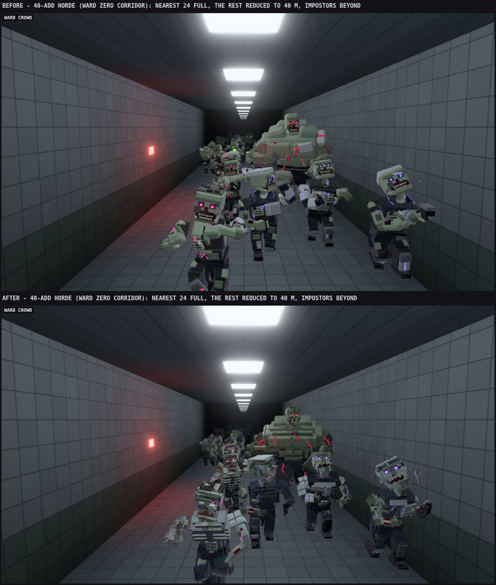
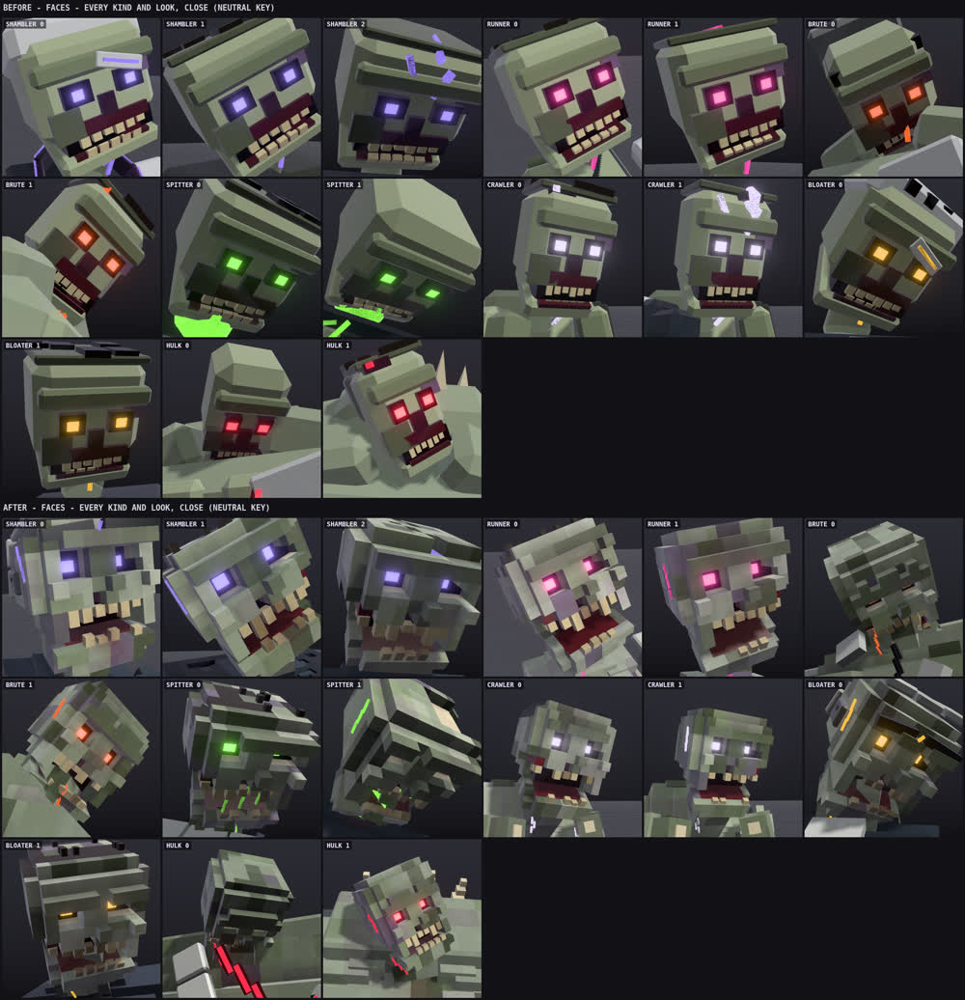

# Zombie design: the Siren's rotted pilots, in voxels

Owner request (2026-10-17): "Yes fix the zombies animations (Design as well, it seems they are still on the lower quality end)
Improve these vastly." A first pass rebuilt the seven kinds as smooth sculpted bodies. The owner rejected it the same day:
"Keep voxel style, just improve it. The sculpted looks odd". This document covers the voxel rework that replaced it.

The task is the design half: models, materials, shading and detail. Motion (poses, gait, follow, secondary motion, attack
curves) is the separate `claude/zombie-motion` task. Presentation only: no hitbox, collider, timing, damage, movement or
network change, and every vertex stays inside the kind's capsule (HordeKindChecks, HulkSpitterChecks).

## What was wrong with the old blocks

Each kind was one bevelled box per limb on the 22-joint rig. A cube head carried a flat face plate with square glowing eyes
and a row of block teeth, and the armour was more boxes. Up close at 1440p it read as a toy. There was no ambient occlusion,
one Lambert response for everything, and every add of a kind and look was identical.

## The aim: a high-end voxel character

The zombies stay the same blocky, armoured voxel pilots as the players (CapturedRig's voxel body, the armoured pilot's
chunky plates), so they sit with the pilots, the world and the blocky bosses. They are built from many small cubes at a few
sizes instead of one box per limb, the way detailed voxel art is:

- **Body voxels** (about 3.5 cm on the pilot; the brute's and the Hulk's grow with them, so they keep the same count of
  blocks). Each part is a grid filled in layers: the suit over the skin over the flesh and the bone.
  - A torn suit is cells taken off with a stepped edge, and the skin layer shows under it.
  - A wound goes one layer deeper, and its ribs are rows of bone voxels.
  - A starved chest has rows of rib with the rows between them sunk a cell.
- **Head voxels** (3.2 cm, the pilot's cube head ten cells wide).
  - Sockets two cells deep with a glowing block pupil at the bottom.
  - A stepped brow with a broken cell.
  - A broken block nose with one half a black hole.
  - Gaunt cheekbones and a mouth cavity three cells deep, black at the back, gums on the roof.
  - Uneven block teeth, one missing and one a long fang.
  - A cheek torn open onto the molars.
  - A block jaw hanging open with its own gums and teeth.
- **Plates.** The pilot's chunky slabs, cracked into tiles that are offset and tilted, with some gone. The helmet is cracked
  into shards: the crown, the back plate, a side plate, the ear module with its dead light, and the visor's brow broken in two.
- **Details (1-2 cm).** Teeth, pupils, block fingers curled in steps with claws or nails, knuckles, block toes. Ink veins
  are stepped glowing strips. The Hulk's splits are stepped glowing cracks over a dark split.
- **Silhouette per kind:**
  - Shambler: lopsided armour.
  - Runner: long and starved, ribs, a spine of bone blocks.
  - Brute and Hulk: stacked, offset block muscle, a hump, rock fists, shards or spurs of bone blocks.
  - Spitter: a throat sac of glowing voxels behind a torn web of skin.
  - Crawler: ribs and wasted legs.
  - Bloater: a voxel gut with glowing boils, the suit torn open over it.

## How it is built

- `Core/NativeZombieKit.cs`, the voxel kit on the existing `WeaponSculpt` path:
  - **`Vox`**: a grid in a joint's frame. Its cells carry a paint and a depth under the surface; paint functions lay the
    layers and cut the tears.
  - **`Voxels`, the mesher**: draws only the faces open to air. Coplanar faces of one paint, shade step and flat occlusion
    merge into larger quads, and each corner carries its voxel occlusion (two sides and the diagonal).
  - **`Tiles`**: cracked plates.
  - **`Strand`, `Chain`**: block rags and cables that sway.
  - **`Zig`**: stepped cracks and veins.
  - **`Finish`**: the occlusion bake (part-on-part spheres, with the grids' own corner occlusion folded in), a stepped
    shade per block, stepped grime toward the hands and feet, ink-blood round the mouth, and the regions.
  - **`Variation`**: the per-add tint.
- `Core/NativeZombieAnatomy.cs`: the palette, the layered grids and the head, jaw, scalp, neck, torso, plates, arms, hands,
  legs and feet.
- `Core/NativeZombieKinds.cs`: the seven kinds as choices on that anatomy, plus their extras: the big kinds' block muscle,
  the spitter's sac, the bloater's gut.
- `Resources/NativeZombieLit.shader`: a Built-in RP surface shader.
  - It keeps every input of the horde shader: scene tint, ink, actor and stage lights, struck flash, death dissolve.
  - It adds per-class lighting with a low wrap so the voxel faces stay crisp, a Blinn sheen per class, and the baked
    occlusion.
  - Per add: the skin is mottled in stepped cells, and it applies proportions, missing pieces and sway.
  - It falls back to the old horde shader if it is missing or unsupported.
- The zone kinds (Ironworks, Station) keep their classic bodies; only the occlusion bake reaches them. `ClassicRunner` and
  `ClassicBrute` stay for the Ironworks kinds that reuse them, so their triangle counts are unchanged.
- Tiers:
  - **Full**: everything.
  - **Reduced** (20-40 m): body voxels 1.4 times larger, one skin paint so faces merge, a head of a dozen blocks on the same
    grid lines, a block gut, fewer cracks and no shade steps.
  - **Impostor**: a block per part and the eyes.

### Shading data (per vertex)

| Channel | Meaning |
| --- | --- |
| `uv0.x` | surface class + 0.02 + 0.96 x occlusion. Classes: 0 plain (old bank), 1 skin, 2 flesh, 3 shell, 4 cloth, 5 bone, 6 matte, 7 wire/metal |
| `uv0.y` | variant (0 always, 1-4 optional piece group) + 0.02 + 0.96 x sway weight |
| `color.a` | proportion region: 1 none, 0.75 head, 0.5 torso width, 0.25 limb girth |

The 0.02/0.96 offset keeps the fraction away from the integer, so interpolation never crosses a class boundary. The mesher
writes a grid corner's own occlusion into the x fraction (`WeaponSculpt.QuadData`) before the bake packs it.

### Per add (instanced `_BodyTint`, white = the model as built)

- `r = 1 + tone` (±0.45): skin lighter and violet, or darker and greener.
- `g = 1 + seed` (0.002-0.998):
  - the stepped mottling's offset;
  - proportions: head ±5 %, torso width ±5 %, limb girth ±7 %, scaled about each joint's origin so the joint never moves.
  The capsule check uses the widest case.
- `b = 1 + mask/16`: four bits. A set bit collapses that variant's vertices to the joint origin.
  - Variant groups: 1 the left arm and leg armour and the visor shard, 2 the chest plates and the brute's shards, 3 the back
    unit, 4 the right arm and leg armour.
  - Mask 15 (everything gone) is never used.

The tint comes from `NativeHordeModels.Variation(id)`, set in `HordeQueue`, `HordeQueueJaw`, `HordePartsDraw` and the death body.
Nothing is allocated per frame.

### Budgets (triangles per model; the old budgets stand)

Budgets per tier: Full (nearest 24) 7,200, Reduced (to 40 m) 3,000, Impostor 600. Measured on every kind and look,
old blocky against the new voxels:

| Kind | Full before | Full after | Reduced before | Reduced after | Impostor before | Impostor after |
| --- | --- | --- | --- | --- | --- | --- |
| Shambler | 3,778-4,362 | 5,816-6,800 | 2,578-2,814 | 2,698-2,918 | 564-576 | 456-564 |
| Runner | 3,936-4,060 | 5,112-5,404 | 2,404-2,560 | 2,150-2,284 | 552 | 348-432 |
| Brute | 3,292-3,328 | 6,450-6,906 | 2,492-2,560 | 2,770-2,930 | 468-516 | 480-516 |
| Spitter | 3,766-4,046 | 5,554-6,124 | 2,566-2,794 | 2,858-2,910 | 564-600 | 432-576 |
| Crawler | 3,232-3,248 | 4,662-4,884 | 2,024-2,028 | 2,072-2,108 | 432-444 | 348-396 |
| Bloater | 3,984-4,232 | 6,224-7,132 | 2,604-2,764 | 2,760 | 528-564 | 432-564 |
| Hulk | 3,786-3,900 | 7,098-7,128 | 1,910-2,012 | 2,618-2,782 | 528-540 | 420 |

All tiers, new:
- Full: 4,662-7,132 (mean 6,126).
- Reduced: 2,072-2,930 (mean 2,625).
- Impostor: 348-576 (mean 462).

Draw calls do not change: each kind keeps the same sections and materials, with one instanced draw per model part. The 40-add
crowd (24 full and 16 reduced, plus 5 hinged jaws) is 402 draws and 212 shadow draws, old and new. Its triangles go from
136,128 to 189,878 (+39 %).

## Dangling parts (for the motion agent)

These are attached to existing joint sections; none is a new joint. Their sway is in the vertex shader (`uv0.y` sway weight,
0 at the root to 1 at the tip; amplitude 1.8 cm x, 2.4 cm z; phase from the add's seed). A motion-side spring could replace it
later; the weights are already in the mesh.

- Block rags: pelvis rags (Pelvis), collar rags (Chest), sleeve stubs on bare arms (LClav/RClav), the shambler's shawl rags
  (Chest), the scalp flap (Head), the big kinds' waist rags (Spine).
- Block cables: under the chest plates (Chest), out of the back unit (Chest), under the pauldrons (LClav/RClav).
- The spitter's drool (Head, from the upper teeth so opening the jaw never drops it) and the shambler's visor shard (Head).

## Notes for motion

- Joints are not renamed or reordered. Only the spitter and the Hulk have a hinged jaw part (the existing jaw model on the
  Head joint), so the motion pass's jaw flap applies to them alone; the other kinds' jaws hang at a fixed slack in the head.
- The motion pass (`claude/zombie-motion`, merged into shared as `97046f7`) is merged into this branch. Its loose-head layer
  lifts the idle head, and the faces read in the new idle (the renders are posed by the combined code). The capsule checks
  pass on the combined poses.
- The variation scales are about joint origins, so poses and planted feet are unaffected.

## Not verified here

No Unity Editor or Windows run. The renders come from an offline WebGL harness that runs the same Core mesh code and a port of
the shader's shared block. It is not Unity. The surface shader compiles through glslang's HLSL front end, not Unity's compiler.
